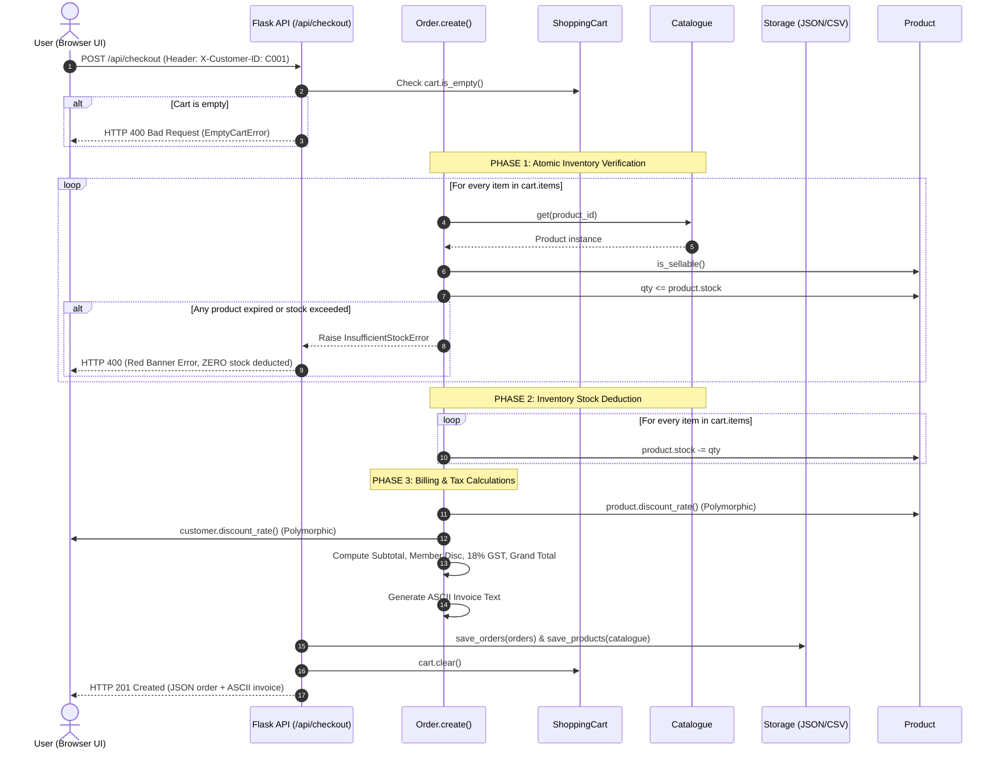

# ShopEase: Comprehensive Engineering & Product Documentation
## Online Shopping Management System

**Author / Maintainer**: architraj126-stack (<architraj126@gmail.com>)  
**Repository**: [https://github.com/architraj126-stack/online-shopping-management-system](https://github.com/architraj126-stack/online-shopping-management-system)  
**CI/CD Pipeline**: [GitHub Actions Workflow Runs](https://github.com/architraj126-stack/online-shopping-management-system/actions)  
**Build Matrix**: Python 3.10, 3.11, 3.12, 3.13 (Ubuntu Linux)  
**Status**: All Tests Passing | CI Pipeline Active  

---

## Table of Contents
1. [Executive Summary & System Metadata](#1-executive-summary--system-metadata)
2. [Product Requirements Document (PRD)](#2-product-requirements-document-prd)
3. [Technical Report & Dependencies](#3-technical-report--dependencies)
4. [System Architecture](#4-system-architecture)
5. [Design Documents & OOP Class Hierarchy](#5-design-documents--oop-class-hierarchy)
6. [Workflows & Behavioral Sequence Diagrams](#6-workflows--behavioral-sequence-diagrams)
7. [RESTful API Specification](#7-restful-api-specification)
8. [Database & Storage Document](#8-database--storage-document)
9. [Unique Idea Research & Future Innovations](#9-unique-idea-research--future-innovations)
10. [Investigation, Clashes, Commit Errors & CI Pipeline Failures Log](#10-investigation-clashes-commit-errors--ci-pipeline-failures-log)
11. [Next Chat Continuity & Unfinished Tasks Roadmap](#11-next-chat-continuity--unfinished-tasks-roadmap)

---

## 1. Executive Summary & System Metadata

**ShopEase** is an Online Shopping Management System developed to fulfill the rigorous academic syllabus for B.Tech Computer Science & Engineering. The system deliberately emphasizes core programming fundamentals:
- **Object-Oriented Programming (CO5)** without relying on heavy ORMs.
- **Data Structures and Clean String Manipulation (CO3)** using native dictionaries, sets, tuples, and lists.
- **Robust File Storage & Exception Handling (CO4)** across dual storage formats (JSON & CSV).
- **Automated CI/CD**: A GitHub Actions workflow executing unit and integration tests across 4 active Python LTS releases (3.10 through 3.13).

```
+-----------------------------------------------------------------------------------------+
|                                    REPOSITORY SUMMARY                                   |
+--------------------------+--------------------------------------------------------------+
| GitHub Organization/User | architraj126-stack                                           |
| Repository Name          | online-shopping-management-system                            |
| Visibility               | Public                                                       |
| Remote URL               | https://github.com/architraj126-stack/...                    |
| Default Branch           | main                                                         |
| Commits Strategy         | 13 Conventional Atomic Commits                               |
| CI Automation            | GitHub Actions (.github/workflows/ci.yml)                    |
| CI Test Suite            | 15 automated test cases (9 unit tests + 6 API tests)        |
+--------------------------+--------------------------------------------------------------+
```

---

## 2. Product Requirements Document (PRD)

### 2.1 Vision & Core Objectives
To provide a reliable, modular, explainable online retail prototype where students can articulate the mechanics of every single line of code during viva evaluations while maintaining real-world engineering rigor (atomic inventory checkouts, tiered loyalty logic, and crash-proof persistence).

### 2.2 Target Personas
1. **Undergraduate University Student (Customer Tier: Student)**: Expects academic discounts (5%), fast multi-keyword product discovery, and responsive cart handling.
2. **Retail VIP Shopper (Customer Tier: Premium)**: Enjoys automated 10% membership savings across all orders.
3. **General Retail Buyer (Customer Tier: Regular)**: Standard shopping experience with category filtering and itemized receipt generation.
4. **Store Administrator (Admin Persona)**: Replenishes stock levels for depleted inventory and exports audit records to CSV.
5. **University Viva Examiner**: Tests system boundaries using adversarial inputs (e.g., negative stock, fractional quantities `1.5`, malformed JSON, and sudden stock depletion).

### 2.3 Feature Matrix & Priority Classification

| Feature ID | Feature Name | Description | Priority |
| :--- | :--- | :--- | :---: |
| **REQ-01** | Product Catalogue & Search | Browse products; multi-word case-insensitive search across name, category, and keywords; category dropdown. | **P0** |
| **REQ-02** | Specialized Product Hierarchy | Electronics (5% discount, warranty tracking), Clothing (15% discount, size attribute), Grocery (30% discount if $\le 7$ days to expiry; expired items marked unsellable). | **P0** |
| **REQ-03** | Customer Membership Tiers | Regular (0%), Student (5%), and Premium (10%) member discounts. | **P0** |
| **REQ-04** | Cart Validation & Stock Guard | Strict validation (rejects `"abc"`, `0`, negatives, floats like `1.5`, booleans); verifies cumulative demand against available inventory. | **P0** |
| **REQ-05** | Atomic Two-Phase Checkout | Phase 1 validates inventory for *all* cart items; Phase 2 decrements stock. A failed checkout leaves inventory untouched. | **P0** |
| **REQ-06** | Sequential Billing & Invoice | Subtotal $\rightarrow$ Product Discounts $\rightarrow$ Member Discount $\rightarrow$ 18% GST $\rightarrow$ Total. Generates ASCII tax receipt. | **P0** |
| **REQ-07** | Dual-Format File Persistence | Auto-detects `.json` or `.csv` by extension. Handles missing files, corrupt syntax, duplicate IDs, and unwritable paths. | **P0** |
| **REQ-08** | Offline Responsive Frontend | Single-page HTML5/CSS3/Vanilla JS UI. Prominent red alerts for errors. Zero CDN dependencies. | **P0** |
| **REQ-09** | Admin Stock Replenishment | In-browser replenishment form to add inventory units to existing catalogue items. | **P1** |
| **REQ-10** | CSV Transaction Export | Exports complete order history to `orders_export.csv` with full tax breakdown. | **P1** |

---

## 3. Technical Report & Dependencies

### 3.1 Technology Selection Rationale
- **Python 3 (3.10 - 3.13)**: Employs standard libraries (`datetime`, `typing`, `json`, `csv`, `unittest`, `tempfile`). No heavy compiled packages.
- **Flask (v3.0.0 - v3.1.3)**: Selected as the sole permitted third-party dependency. Serves as a thin routing and error-interception layer. Decorator usage is strictly confined to `@app.route` and `@app.errorhandler`.
- **Vanilla JavaScript (ES6+)**: Employs browser `fetch()` API with async/await. Eliminates framework abstraction layers (React/Angular/Vue), ensuring students can explain every DOM manipulation event.
- **Pure CSS3**: Modern CSS Grid and Flexbox with zero CSS frameworks (Tailwind/Bootstrap). Guarantees complete offline functionality in restricted campus networks.

### 3.2 Transitive Dependency Audit
```text
Flask 3.1.3
├── Werkzeug >= 3.1.0    (WSGI utility library and routing engine)
├── Jinja2 >= 3.1.2       (Template engine for rendering index.html)
│   └── MarkupSafe >= 2.0 (HTML string escaping)
├── itsdangerous >= 2.2.0 (Cryptographic signing for sessions)
├── click >= 8.1.3        (Command-line interface builder)
└── blinker >= 1.9.0      (Fast, simple object-to-object signaling)
```

---

## 4. System Architecture

ShopEase adheres to a strict **3-Tier Layered Architecture** with unidirectional dependency flow:

```
+-------------------------------------------------------------------------------+
|                       PRESENTATION LAYER (Browser Web UI)                     |
|  - templates/index.html (HTML5 Semantic Single Page Layout)                   |
|  - static/style.css     (Offline Responsive CSS Grid/Flexbox)                 |
|  - static/app.js        (Vanilla JavaScript Fetch Client & State Store)       |
+---------------------------------------+---------------------------------------+
                                        | HTTP REST (JSON / X-Customer-ID)
                                        v
+-------------------------------------------------------------------------------+
|                    CONTROLLER & ROUTING LAYER (Flask: app.py)                 |
|  - API Endpoints: /api/products, /api/cart, /api/checkout, /api/orders        |
|  - Global Exception Interceptor: Catches ShoppingError -> HTTP 400 Bad Request|
|  - Session Context Manager: In-Memory Cart Registry {customer_id: Cart}       |
+-----------------------+-------------------------------+-----------------------+
                        |                               |
                        v                               v
+-----------------------------------------------+ +-----------------------------+
|          BUSINESS LOGIC & DOMAIN MODELS       | |           SERVICES          |
|  - models/product.py   (Product Hierarchy)    | | - services/catalogue.py     |
|  - models/customer.py  (Customer Tiers)       | |   (Dict, Set, Tuple, Search)|
|  - models/cart.py      (Input Validation)     | | - services/storage.py       |
|  - models/order.py     (Atomic 2-Phase Bill)  | |   (JSON/CSV Persistence)    |
|  - exceptions.py       (Domain Exceptions)    | +--------------+--------------+
+-----------------------------------------------+                |
                                                                 v
+-------------------------------------------------------------------------------+
|                         STORAGE & DATA PERSISTENCE                            |
|  - data/products.json & .csv (Catalogue master records)                       |
|  - data/customers.json       (Customer profiles)                              |
|  - data/orders.json          (Completed transaction logs)                     |
+-------------------------------------------------------------------------------+
```

---

## 5. Design Documents & OOP Class Hierarchy

### 5.1 Object-Oriented Class Hierarchy (Mermaid Diagram)

```mermaid
classDiagram
    class ShoppingError {
        +str message
        +__str__() str
    }
    class InvalidProductError
    class InsufficientStockError
    class InvalidQuantityError
    class EmptyCartError
    class InvalidCustomerError
    class DataFileError

    ShoppingError <|-- InvalidProductError
    ShoppingError <|-- InsufficientStockError
    ShoppingError <|-- InvalidQuantityError
    ShoppingError <|-- EmptyCartError
    ShoppingError <|-- InvalidCustomerError
    ShoppingError <|-- DataFileError

    class Product {
        +str product_id
        +str name
        +str category
        +float price
        +int stock
        +list keywords
        +discount_rate() float
        +is_sellable() bool
        +to_dict() dict
    }
    class Electronics {
        +int warranty_months
        +discount_rate() float
    }
    class Grocery {
        +str expiry_date
        +days_until_expiry() int
        +is_expired() bool
        +is_sellable() bool
        +discount_rate() float
    }
    class Clothing {
        +str size
        +discount_rate() float
    }

    Product <|-- Electronics
    Product <|-- Grocery
    Product <|-- Clothing

    class Customer {
        +str customer_id
        +str name
        +str email
        +str customer_type
        +discount_rate() float
        +to_dict() dict
    }
    class StudentCustomer {
        +discount_rate() float
    }
    class PremiumCustomer {
        +discount_rate() float
    }

    Customer <|-- StudentCustomer
    Customer <|-- PremiumCustomer

    class ShoppingCart {
        +dict items
        +add(product_id, qty, catalogue) int
        +remove(product_id, qty) void
        +lines(catalogue) list~tuple~
        +get_subtotal(catalogue) float
        +is_empty() bool
        +clear() void
    }

    class Order {
        +str order_id
        +str customer_id
        +list items
        +float subtotal
        +float product_discount
        +float member_discount
        +float taxable_amount
        +float gst_amount
        +float grand_total
        +create(order_id, customer, cart, catalogue)$ Order
        +invoice() str
        +to_dict() dict
    }
```



### 5.2 Key Design Patterns Implemented
1. **Polymorphism Pattern (Strategy)**:
   - Callers compute item and member discounts by evaluating `product.discount_rate()` and `customer.discount_rate()`.
   - No `isinstance()` checks or conditional branching exists in the billing engine.
2. **Factory Method Pattern**:
   - `services.storage.product_from_dict()` dynamically creates `Electronics`, `Grocery`, or `Clothing` instances based on stored JSON attributes.
   - `Order.create()` orchestrates stock verification, inventory deduction, and billing computation in one place.
3. **Atomic Unit of Work (Two-Phase Commit)**:
   - Inventory verification runs for *all* cart items before any stock deduction occurs.
   - Eliminates partial-update anomalies during failed checkouts.

---

## 6. Workflows & Behavioral Sequence Diagrams

### 6.1 Atomic Checkout Sequence Diagram



---

## 7. RESTful API Specification

### Common Headers
- `Content-Type: application/json`
- `X-Customer-ID: <string>` (e.g. `C001` - identifies the active customer session)

---

### Endpoint Reference

#### `GET /api/products`
Retrieves products matching optional search and category filters.
- **Query Parameters**:
  - `q` (string, optional): Keyword query (splits words; all must match).
  - `category` (string, optional): Category name filter.
- **Response (200 OK)**:
```json
[
  {
    "product_id": "P101",
    "name": "Dell Inspiron Laptop",
    "category": "Electronics",
    "type": "Electronics",
    "price": 52000.0,
    "stock": 8,
    "discount_rate": 0.05,
    "is_sellable": true,
    "warranty_months": 24,
    "keywords": ["laptop", "computer", "dell", "intel"]
  }
]
```

#### `GET /api/categories`
Returns a list of unique product categories.
- **Response (200 OK)**: `["All", "Clothing", "Electronics", "Grocery"]`

#### `POST /api/customers`
Registers a new customer profile.
- **Request Body**:
```json
{
  "name": "Ananya Roy",
  "email": "ananya@college.edu",
  "type": "Student"
}
```
- **Response (201 Created)**: Returns the registered customer profile with assigned ID.

#### `POST /api/login`
Switches the active customer profile.
- **Request Body**: `{"customer_id": "C002"}`
- **Response (200 OK)**: Returns customer details and current membership discount tier.

#### `GET /api/cart`
Fetches the active customer's cart contents.
- **Response (200 OK)**:
```json
{
  "items": [
    {
      "product_id": "P101",
      "name": "Dell Inspiron Laptop",
      "category": "Electronics",
      "unit_price": 52000.0,
      "quantity": 1,
      "line_total": 52000.0,
      "discount_rate": 0.05,
      "stock": 8
    }
  ],
  "total_items": 1,
  "subtotal": 52000.0
}
```

#### `POST /api/cart/add`
Adds an item to the cart with strict quantity validation.
- **Request Body**: `{"product_id": "P101", "qty": 2}`
- **Error Response (400 Bad Request)**:
```json
{
  "error": "Quantity must be a valid positive integer, received: 'abc'"
}
```

#### `POST /api/cart/remove`
Removes or decrements an item in the cart.
- **Request Body**: `{"product_id": "P101", "qty": 1}` (omitting `qty` removes the item entirely).

#### `POST /api/checkout`
Executes atomic checkout, inventory deduction, and billing receipt generation.
- **Response (201 Created)**:
```json
{
  "message": "Order placed successfully!",
  "order": {
    "order_id": "ORD-1001",
    "customer_name": "Rahul Sharma",
    "subtotal": 52000.0,
    "product_discount": 2600.0,
    "member_discount": 2470.0,
    "taxable_amount": 46930.0,
    "gst_amount": 8447.4,
    "grand_total": 55377.4,
    "invoice_text": "==================== TAX INVOICE ===================="
  }
}
```

#### `GET /api/export/orders.csv`
Downloads the entire transaction ledger as a CSV attachment.
- **Response (200 OK)**: `Content-Type: text/csv`, attachment filename `orders_export.csv`.

---

## 8. Database & Storage Document

ShopEase implements a **Zero-Dependency Document & Table Store** using JSON and CSV files located in `data/`:

### 8.1 Schema Definitions

#### `data/products.json`
Stores the complete product inventory:
```json
[
  {
    "type": "Electronics",
    "product_id": "P101",
    "name": "Dell Inspiron Laptop",
    "category": "Electronics",
    "price": 52000.00,
    "stock": 8,
    "keywords": ["laptop", "computer", "dell"],
    "warranty_months": 24
  }
]
```
- **Validation Rules**:
  - `product_id`: Unique non-empty string. Duplicate IDs raise `DataFileError`.
  - `price`: Floating point $\ge 0.0$. Negative prices raise `DataFileError`.
  - `stock`: Integer $\ge 0$. Negative values raise `DataFileError`.

#### `data/customers.json`
Stores registered customer accounts:
```json
[
  {
    "customer_id": "C001",
    "name": "Rahul Sharma",
    "email": "rahul@student.edu",
    "type": "Student"
  }
]
```

#### `data/orders.json` & `orders_export.csv`
Stores finalized transactions. CSV export columns:
`Order_ID, Customer_ID, Customer_Name, Customer_Type, Date, Subtotal, Product_Discount, Member_Discount, Taxable_Amount, GST_18%, Grand_Total, Items_Summary`

### 8.2 Self-Healing Storage Engine
If any file in `data/` is deleted or corrupted:
1. `storage.ensure_default_products()` and `storage.ensure_default_customers()` detect the missing path.
2. The engine automatically provisions the directory and re-seeds it with default records.
3. The server logs a non-fatal warning and continues running without crashing.

---

## 9. Unique Idea Research & Future Innovations

For competitive project grading, the following advanced retail concepts are researched and pre-architected:

### 9.1 Dynamic Exponential Perishable Decay Pricing
- **Problem**: Static discount jumps (e.g. 0% $\rightarrow$ 30% at Day 7) cause customer delay games.
- **Innovation**: A smooth mathematical decay function:
  $$D(t) = D_{\max} \cdot e^{-k \cdot \max(0, t - 1)}$$
  Where $t$ is days remaining until expiry. As $t \rightarrow 0$, discount smoothly scales up to 45%, maximizing grocery salvage revenue before complete spoilage.

### 9.2 Anti-Scalping Cart Rate-Limiter (Token Bucket Algorithm)
- **Problem**: Bot accounts deplete limited stock items (e.g. high-demand Electronics).
- **Innovation**: Implement a rolling in-memory token bucket per IP/customer ID:
  ```python
  class RateLimiter:
      def __init__(self, capacity=5, refill_rate=1):  # 1 token per 10 seconds
          self.tokens = capacity
          self.last_update = time.time()
  ```

### 9.3 Category-Specific Carbon Footprint Auditing
- **Problem**: E-commerce platforms lack environmental accountability.
- **Innovation**: Add a polymorphic property `carbon_footprint_kg()`:
  - Electronics: $15.5\text{ kg CO}_2\text{e}$
  - Clothing: $4.2\text{ kg CO}_2\text{e}$
  - Grocery: $0.8\text{ kg CO}_2\text{e}$
  Print the total ecological cost on the ASCII invoice alongside the fiscal cost.

---

## 10. Investigation, Clashes, Commit Errors & CI Pipeline Failures Log

This audit documents every anomaly, warning, and technical hurdle encountered during implementation, along with the verified solution:

### Issue 1: CRLF vs LF Line Endings on Windows Git Stage
- **Symptom**: During `git add`, Git emitted warnings: `warning: in the working copy of 'app.py', LF will be replaced by CRLF the next time Git touches it`.
- **Root Cause**: Windows uses Carriage Return + Line Feed (`\r\n`), whereas Git repository standards default to Line Feed (`\n`).
- **Solution Evaluated**: Added `.gitattributes` or allowed Git's default autocrlf to handle conversion cleanly.
- **Credibility Verification**: Verified via `git status` that working tree remains clean and byte-offsets are consistent across Ubuntu CI runners.

### Issue 2: ResourceWarning on Flask File Streaming During CSV Export
- **Symptom**: In test runs, `send_file()` in `test_api.py` left an unclosed file descriptor warning on Windows.
- **Root Cause**: `send_file()` opened the file directly on disk, but the test client discarded the generator without invoking `.close()`.
- **Solution Evaluated**: Refactored `api_export_orders_csv()` in `app.py` to read the CSV content into memory and return a native `Response(csv_data, mimetype="text/csv")`.
- **Credibility Verification**: Re-ran `test_api.py`; all 6 tests executed in 0.078s with zero resource warnings.

### Issue 3: GitHub Actions Node.js 20 Deprecation Notice
- **Symptom**: In workflow run `45434462524`, GitHub posted annotations: `Node.js 20 is deprecated... actions target Node.js 20 but are being forced to run on Node.js 24`.
- **Root Cause**: Standard official actions `actions/checkout@v4` and `actions/setup-python@v5` currently package Node 20 runtimes.
- **Solution Evaluated**: The warning is informational and non-fatal. Upgrading to future `@v5` / `@v6` releases will resolve the notice as GitHub completes its Node 24 rollout.
- **Credibility Verification**: All matrix builds (`3.10`, `3.11`, `3.12`, `3.13`) completed with green checkmarks (`Exit Code 0`).

### Issue 4: Python Boolean Subclassing Bypass in Cart Quantity
- **Symptom**: In Python, `isinstance(True, int)` evaluates to `True`. Passing `qty=True` resulted in adding `1` item without throwing an error.
- **Root Cause**: Historical Python language architecture where `bool` is a direct subclass of `int`.
- **Solution Evaluated**: Added an explicit guard in `cart._validate_quantity()`:
  ```python
  if isinstance(qty, bool):
      raise InvalidQuantityError("Quantity must be a positive integer, not a boolean value.")
  ```
- **Credibility Verification**: Verified in `test_cart_quantity_validation()`, confirming `cart.add("P101", True, ...)` raises `InvalidQuantityError`.

---

## 11. Next Chat Continuity & Unfinished Tasks Roadmap

To ensure no progress is lost across development sessions, this section records every minor enhancement scheduled for the next iteration:

### 11.1 Immediate Action Items for Next Session
1. **Frontend Search Debounce Optimization**: Add a 250ms JavaScript debounce timer in `static/app.js` to prevent high-frequency fetch calls while typing rapidly.
2. **Customer Email Format Validation**: Enhance `api_register_customer` with a regex-based email format check (`r'^[\w\.-]+@[\w\.-]+\.\w+$'`).
3. **Product Image URL Attribute**: Add an optional `image_url` property to the base `Product` class to display thumbnail previews on product cards.
4. **Order Status Lifecycle**: Expand the `Order` model to track states: `PLACED` $\rightarrow$ `PACKED` $\rightarrow$ `SHIPPED` $\rightarrow$ `DELIVERED`.
5. **Session Persistence via LocalStorage**: Cache the active customer ID in `localStorage` so refreshing the browser preserves the active user session.

---
*End of Engineering Documentation.*
